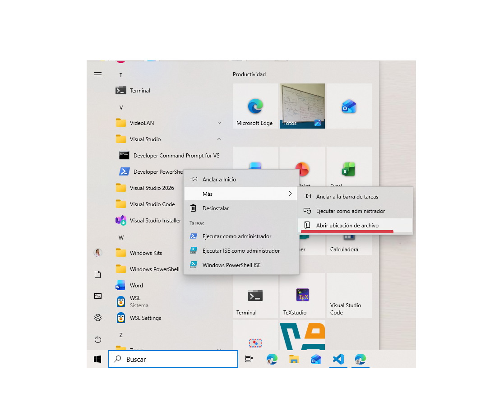
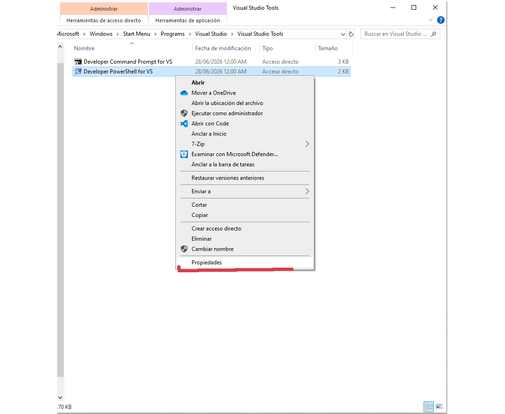
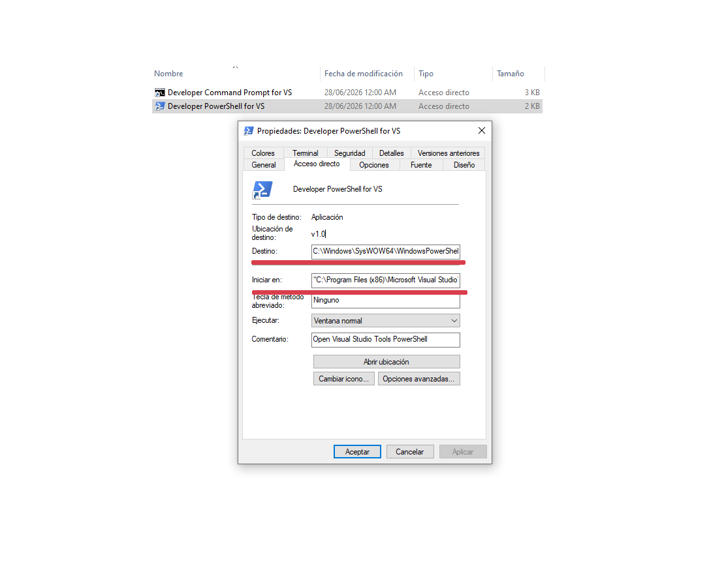

# Developer Powershell Prompt en VS Code

Esta es una pequeña configuración para agregar "dev ps" en vs code,
asi puede usarse las herramientas de msvc de visual studio en la terminal VS Code.

## Configuración para activar "developer powershell prompt" en vs code

``` json
"Developer PowerShell": {
    "path": "${env:windir}\\SysWOW64\\WindowsPowerShell\\v1.0\\powershell.exe",
    "args": [
        "-noe",
        "-c",
        "&{Import-Module '${env:ProgramFiles(x86)}\\Microsoft Visual Studio\\18\\BuildTools\\Common7\\Tools\\Microsoft.VisualStudio.DevShell.dll'; Enter-VsDevShell 'd8a9a8c6'}",
        "'${env:ProgramFiles(x86)}\\Microsoft Visual Studio\\18\\BuildTools\\'",
    ],
    "icon": "terminal-powershell",
}
```

### ¿Como se supone que funciona?

Paso a Paso

1. Lanzar un prompt de powershell comun y corriente.
2. Prepara argumentos -noe (Evitar cierre) y -c interpretar shell.
3. Interpreta el comando Import-Module, el cual inyecta la libreria de DevShell osea toda las herramientas de dessarrollo, luego accede a el.
4. Setea el prompt dentro de la carpeta buildtools de Vs.

### ¿Como lo puedo replicar?

1. Accede al acceso directo de la powershell de desarrollo en el menu de inicio, has click derecho selecciona "Abrir ubicacion del archivo".


2. En el directorio abierto haz click derecho sobre propiedades sobre el acceso directo.


3. Al abrir el menu de propiedades copia el contenido de los campos "Destino" y "Iniciar en":
_Destino_: La dirección donde abre la aplicación de powershell del sistema y los argumentos para importar y cargar el modulo de devtool.
_Iniciar en_: La dirección donde se movera el prompt para ejecutar las devtools.


4. Desglozar la información del campo "_Destino_" y "_Iniciar en_":
Powershell: C:\\Windows\\SysWOW64\\WindowsPowerShell\\v1.0\\powershell.exe
Argumento para mantener la shell encendida: -noe. (Si, tal parece que cargar la devtool sin esto hace que se cierre powershell)
Argumento para importar modulo: -c
Comando de importación: "&{Import-Module """C:\Program Files\Microsoft Visual Studio\18\BuildTools\Common7\Tools\Microsoft.VisualStudio.DevShell.dll"""; Enter-VsDevShell d8a9a8c6}".
Iniciar en Devtools: "C:\Program Files (x86)\Microsoft Visual Studio\18\BuildTools\".

5. Traducir lo anterior a algo comprensible para vscode:
Ajà directamente vs code parece que no puede entender sintaxis de powershell tan directa, pero eso sucede
porque originalmente windows usa las '"' para interpolar comando, en cambio vscode no... Por ello solo hay que limpiar
todo las '"' innecesarias pero de solo dejar algunas para que vs code pueda con sus propios variables de entorno
poder conseguir las rutas y interpretarlas bien. Entonces aqui dejo la lista:

    5.a C:\\ProgramFiles\\ = ```${env:ProgramFiles} | ${env:ProgramFiles(x86)} -> para x86 bit, depende de su instalación```

    5.b ```C:\\Windows = ${env:windir}```

    5.c ```ps "&{Import-Module """C:\Program Files (x86)\Microsoft Visual Studio\18\BuildTools\Common7\Tools\Microsoft.VisualStudio.DevShell.dll"""; Enter-VsDevShell d8a9a8c6}"``` pasa a ser ```json "&{Import-Module '${env:ProgramFiles(x86)}\\Microsoft Visual Studio\\18\\BuildTools\\Common7\\Tools\\Microsoft.VisualStudio.DevShell.dll'; Enter-VsDevShell 'd8a9a8c6'}"```

    5.d. pasa a ser
```json "'${env:ProgramFiles(x86)}\\Microsoft Visual Studio\\18\\BuildTools\\'"```

6. Ahora al tener todo esto reemplaza el ejemplo de arriba, con todo lo que conseguiste.
7. Abre VsCode entre en la configuracion, y abre una nueva (o busca): "terminal.integrate.profiles.windows" vas a colocar tu configuracion adentro y listo.
